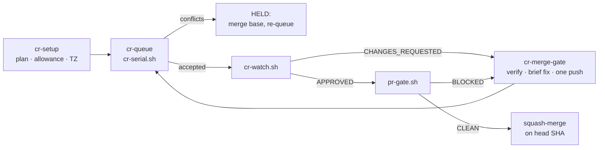

# coderabbit-queue

> A Claude Code plugin that runs pull requests through [CodeRabbit](https://coderabbit.ai) **under its rate limits**, one review at a time, and merges **only when every review on the head is truly clean**.


---

## Contents

- [Why](#why)
- [What you get](#what-you-get)
- [How it works](#how-it-works)
- [Requirements](#requirements)
- [Install](#install)
- [Quick start](#quick-start)
- [The three skills](#the-three-skills)
- [Scripts reference](#scripts-reference)
- [Configuration](#configuration)
- [Plans, rate limits and time zones](#plans-rate-limits-and-time-zones)
- [The rules it enforces (and why)](#the-rules-it-enforces-and-why)
- [Troubleshooting](#troubleshooting)
- [FAQ](#faq)
- [Contributing](#contributing)

---

## Why

CodeRabbit limits reviews **per developer per hour**, and heavy use steps the allowance down — to **1 review an hour** on a busy week. Several AI coding sessions working in parallel will happily fire `@coderabbitai full review` on five PRs at once, hit the limit on all of them, and waste the slots. Worse, an `APPROVED` review can arrive seconds after a `COMMENTED` review full of **follow-up comments**, so "merge on approval" quietly ships unreviewed problems.

This plugin turns the workflow that fixed both problems into three Claude Code skills and a few small, tested shell scripts.

## What you get

| | |
|---|---|
| **Setup** | Detects your GitHub user, CodeRabbit **plan**, the **current** reviews-per-hour (including fair-usage step-downs), seat problems, and the machine **timezone** |
| **A real queue** | One full-review request at a time per repo across every terminal on the machine; waits exactly as long as CodeRabbit says |
| **Honest acceptance** | Re-reads CodeRabbit's reply because it edits "review triggered" into "rate limited" or "Review failed" minutes later |
| **No wasted slots** | Skips PRs that merged or closed while waiting; **holds** PRs that conflict with their base |
| **A merge gate** | Blocks the merge on follow-ups, nitpicks, actionable comments, unresolved threads, late "failed" comments, or conflicts — even when the PR is APPROVED |
| **Lessons file** | A template for the checklist your authors read before every push |

## How it works



## Requirements

| Tool | Why |
|---|---|
| [Claude Code](https://code.claude.com) | Runs the skills |
| `bash` 4+, `flock` (util-linux) | The queue. macOS: `brew install util-linux` and put `flock` on `PATH` |
| [`gh`](https://cli.github.com) logged in | Comments, reviews, merges (`gh auth status`) |
| `python3` | Reads and writes the JSON config |
| [CodeRabbit](https://coderabbit.ai) app on the repo | The reviewer |
| CodeRabbit CLI *(recommended)* | Local pre-review before spending a slot: `coderabbit review --agent` |

## Install

In a terminal:

```bash
claude plugin marketplace add KhaledAbdellaty/coderabbit-queue
claude plugin install coderabbit-queue@cofounder-studio-coderabbit
```

Or inside Claude Code: `/plugin marketplace add KhaledAbdellaty/coderabbit-queue`, then `/plugin install coderabbit-queue@cofounder-studio-coderabbit`.

> The repository is private: you need read access to it, and `gh`/git must be authenticated.

For local development, load it straight from a clone:

```bash
claude --plugin-dir ./plugins/coderabbit-queue
```

## Quick start

Inside your project, ask Claude Code:

1. **"Set up the CodeRabbit queue for this repo."** → runs **cr-setup** and reports plan, allowance and timezone.
2. **"Queue reviews for #12 and #14."** → **cr-queue** queues both and starts a watcher.
3. When a verdict lands: **"#12 was approved — can we merge?"** → **cr-merge-gate** runs the gate and merges only if it's clean, or briefs the fixes.

Or run the scripts yourself (from the repo directory):

```bash
S=~/.claude/plugins/…/coderabbit-queue/scripts   # or ./plugins/coderabbit-queue/scripts
bash $S/cr-setup.sh
bash $S/cr-serial.sh 12 14 &        # queue
bash $S/cr-watch.sh 12 14           # wait for a verdict
bash $S/pr-gate.sh 12               # CLEAN or BLOCKED + reasons
```

## The three skills

| Skill | When it triggers | What it does |
|---|---|---|
| **cr-setup** | First use in a repo; reviews rate-limited at an unexpected pace; "what plan do we have?" | Detects user, base, plan, allowance, seat problems, timezone; writes the config |
| **cr-queue** | PRs ready for review or re-review; "queue / re-queue / how's the queue?" | Pre-queue checklist, runs `cr-serial.sh` and `cr-watch.sh` in the background |
| **cr-merge-gate** | A verdict arrives; before merging on approval; "is #N safe to merge?" | Runs `pr-gate.sh`; merges on the pinned SHA, or verifies findings and briefs one fix push |

Three skills, not one: each fires at a different moment, so each loads only what that moment needs.

## Scripts reference

All scripts live in `plugins/coderabbit-queue/scripts/`, read the repo from the current directory (or `CRQ_REPO=owner/repo`), and need the config from `cr-setup.sh`.

| Script | Usage | Exit codes |
|---|---|---|
| `cr-setup.sh` | `[--rph N] [--base B] [--tz Area/City] [--probe PR]` | 0 ok · 2 not logged in / not a repo |
| `cr-post.sh` | `<pr>` — request one full review and confirm it started | 0 accepted · 3 held (conflicts) · 1 gave up |
| `cr-serial.sh` | `<pr> [<pr>...]` — the queue (per-repo `flock`) | 0 |
| `cr-watch.sh` | `[--since UTC] <pr>...` — exits on the first verdict | 0 verdict · prints `timeout` after ~12 h |
| `pr-gate.sh` | `<pr>` — pre-merge gate | 0 CLEAN · 1 BLOCKED |
| `lib.sh` | sourced helpers (config, UTC/local time, log) | — |

`--probe <pr>` posts `@coderabbitai rate limit` on that PR to read the live allowance — it **writes a comment**, so it's off by default.

## Configuration

`cr-setup.sh` writes `~/.config/coderabbit-queue/<owner>__<repo>.json` (override the folder with `CRQ_HOME`):

```json
{
  "repo": "acme/shop",
  "base": "main",
  "user": "octocat",
  "timezone": "Africa/Cairo",
  "coderabbit_cli": "0.9.2",
  "plan": "Team",
  "reviews_per_hour": 1,
  "reviews_per_hour_source": "CodeRabbit 'Included review availability'",
  "included_reviews_remaining": 0,
  "seat_problem_seen": false,
  "slot_seconds": 3630,
  "bot_login_regex": "coderabbit",
  "watch_interval_seconds": 240,
  "detected_at": "2026-10-31T21:31:04Z"
}
```

Edit it by hand to tune `slot_seconds` or `watch_interval_seconds`, or re-run setup. The queue log sits next to it as `<owner>__<repo>.log`.

## Plans, rate limits and time zones

CodeRabbit has **no public API for plan or seats**, so setup reads CodeRabbit's own words from your 15 most recent PRs:

| Signal | Where CodeRabbit writes it |
|---|---|
| Plan | `Plan: <name>` in a review's *Run configuration* |
| Current allowance | *Included review availability: … allowance at N review(s) per hour … N included reviews remain* |
| Seat problem | a "not assigned a seat" notice |

If nothing is found it falls back to the [documented full-rate caps](https://docs.coderabbit.ai/management/rate-limits) — Essentials 5/h, Team 8/h, Advanced 10/h, Enterprise 12/h — or a safe 1/h for an unknown plan. Limits are **per developer**, refill gradually, and step down with heavy 7-day use, which is why the *detected* allowance wins over the plan default.

**Time zones.** Every calculation uses **UTC**; your timezone (from `timedatectl`, `/etc/timezone` or `$TZ`) is only used to *show* times in logs and messages — e.g. `next try at 2026-10-31 23:47 EET`. Two machines in different zones see the same queue.

## The rules it enforces (and why)

Each rule comes from a real failure.

| Rule | What went wrong without it |
|---|---|
| Never review a PR that conflicts with its base | The review is wasted once the merge changes the code |
| Re-read CodeRabbit's reply twice, minutes apart | "review triggered" was later edited to "Review failed"; the queue thought it had a review |
| Only read replies created after the post, all pages | An old "review triggered" on a long PR looked like acceptance |
| One request at a time per repo (`flock`) | Parallel posts all hit the per-developer limit |
| Skip PRs merged/closed while waiting | Slots spent on already-merged PRs |
| Gate checks **every** review on the head | A "Follow-up Comments" review landed seconds before APPROVED and was missed |
| Merge pinned to the head SHA | A push between the check and the merge would merge unreviewed code |
| Replace scripts with temp file + `mv`, never edit in place | Bash reads scripts lazily; editing a running queue corrupted it |
| Always `@coderabbitai full review` | Plain `review` skips commits it considers already reviewed |

## Troubleshooting

| Symptom | Fix |
|---|---|
| `No config for owner/repo` | Run `cr-setup.sh` in that repo |
| Queue never posts | Another queue job holds the lock: check `~/.config/coderabbit-queue/*.log` |
| `SKIP #N (held: conflicts…)` | Merge the base into the PR, push, re-queue |
| Every request is rate limited | Re-run `cr-setup.sh`; if the allowance is 1/h, the 7-day fair-usage step-down is active — wait, or ask the account owner about usage-based reviews |
| `mergeable=UNKNOWN` in the gate | GitHub hasn't computed it yet; re-run in a minute |
| Gate BLOCKED on an old nitpick you already fixed | It only reads reviews on the **current** head — push the fix and re-queue so CodeRabbit reviews the new head |

## FAQ

**Does it merge automatically?** No. The gate prints the merge command; Claude (or you) runs it after a CLEAN result.

**Does setup post anything?** Only with `--probe`. By default it only reads.

**Can I use another reviewer bot?** Set `bot_login_regex` in the config; the acceptance phrases are CodeRabbit-specific.

**Windows?** Use WSL.

## Contributing

1. Keep scripts POSIX-friendly bash with no extra dependencies beyond the requirements table.
2. `bash -n` every script, and test against a real repo with a throwaway `CRQ_HOME`.
3. Every new rule gets a row in *The rules it enforces* with the failure that motivated it.

Validate the plugin before pushing:

```bash
claude plugin validate .
```

---

Made by [The Co-Founder Studio](https://github.com/TheCoFounderStudio). No license file yet — all rights reserved until one is added.
